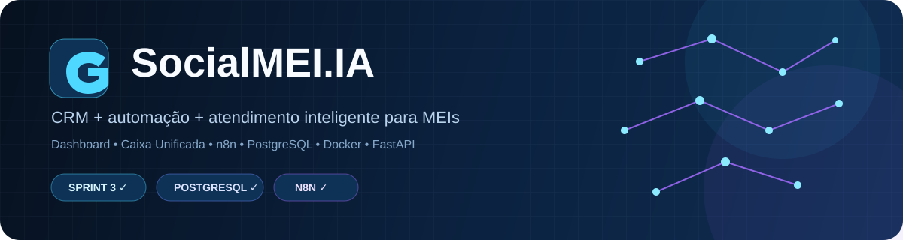

# SocialMEI.IA

CRM experimental para MEIs: atendimento, clientes, produtos e serviços, vendas e financeiro em uma interface de HTML, CSS e JavaScript puro.



[Desenvolvimento](DEVELOPMENT.md) · [Arquitetura](ARCHITECTURE.md) · [Contas](docs/CONTAS-MEIS.md) · [Operação](docs/OPERACAO-EQUIPE.md) · [Revisão da base](PROJECT-BASELINE-REVIEW.md)

## Estado do projeto

A versão da equipe possui API FastAPI, persistência PostgreSQL e autenticação por convite com isolamento de negócio. O Pages continua sendo uma demonstração local. WhatsApp real, IA remota, recuperação por e-mail e execução automática das regras ainda não estão homologados.

| Área                    | Implementação atual                                                                                                                       |
| ----------------------- | ----------------------------------------------------------------------------------------------------------------------------------------- |
| Contas                  | Login, sessão revogável, convite e administração quando a autenticação remota está habilitada; Basic do gateway é uma proteção adicional. |
| Clientes e catálogo     | CRUD por API/PostgreSQL ou local, conforme a configuração; versões, importação e validação monetária.                                     |
| Vendas e financeiro     | Operações com identidade, recuperação de resposta perdida, estoque transacional, histórico e exclusão lógica no modo remoto.              |
| Relatórios              | Indicadores e CSV sobre os dados carregados; não são prova de uma integração de atendimento.                                              |
| Caixa Unificada         | Demonstração local ou leitura legada configurada; notas/rascunhos locais. O composer não envia ao WhatsApp.                               |
| Assistente e automações | Sugestões/regras locais e execução simulada; não ativam IA remota ou workflows n8n.                                                       |
| Canais                  | Fundação de banco preparada; conexão, adaptador, autorização e idempotência do atendimento permanecem etapas próprias.                    |

**Git, CI e runtime são evidências diferentes.** Um merge não atualiza automaticamente a API da AWS. O [inventário vivo](docs/LIVE-ENVIRONMENT-INVENTORY.md) registra coletas anteriores e lacunas; a [revisão da estabilização](PROJECT-BASELINE-REVIEW.md) identifica o que foi testado nesta rodada.

## Rodar a demonstração

Com Git e Python 3:

```bash
git clone https://github.com/socialmei-ia/SocialMEI-IA.git
cd SocialMEI-IA
python -m http.server 5500
```

Abra http://localhost:5500. O `index.html` redireciona para **`frontend/socialmei-app.html`**, a fonte principal. Não há build para servir o frontend; mantenha CSS, scripts e assets juntos. A configuração pública fica em `frontend/config.js` e nunca deve conter segredos.

## Desenvolver com banco local

Com Node 22+, Python e Docker/Compose:

```bash
npm ci
npm run doctor
npm run setup
npm run dev
```

A preparação cria arquivos locais; não execute esses comandos sobre a pasta de produção. O ambiente local usa `compose.dev.yaml`, separado da equipe e do legado. Veja [onboarding de desenvolvimento](docs/ONBOARDING.md) e [DEVELOPMENT.md](DEVELOPMENT.md).

## Onde alterar

| Diretório/arquivo                   | Responsabilidade                                                                         |
| ----------------------------------- | ---------------------------------------------------------------------------------------- |
| `frontend/socialmei-app.html`       | Estrutura da aplicação e experiência pública.                                            |
| `frontend/scripts/`                 | Stores, autenticação, telas, diálogos e navegação; scripts clássicos na ordem do HTML.   |
| `frontend/styles/`                  | Design atual, temas e estilos de contas; sem framework.                                  |
| `frontend/admin.html`               | Administração autenticada.                                                               |
| `python-service/`                   | API, autorização e testes de contrato/integração.                                        |
| `database/migrations/`              | Evolução incremental do schema; nunca reescrever migrations instaladas.                  |
| `database/team-readonly-access.sql` | Perfil administrativo de consulta preparado para concessão individual; aplicação manual. |
| `n8n-workflows/`                    | Sete exports classificados e inativos; não representam integralmente o runtime n8n.      |
| `tools/`                            | Preparação, operação, backup e migrador.                                                 |
| `tests/`                            | Regressões de frontend, stores e operação.                                               |
| `docs/`                             | Guias, contratos e evidências datadas.                                                   |

## Testar

```bash
npm ci
npm test
npm run format:check
python -m pip install -r python-service/requirements.txt
python -m unittest discover -s python-service -p 'test_*.py'
python -m unittest discover -s tests -p 'test_*.py'
npx playwright install chromium
npm run test:browser
node tests/stability-browser.cjs
```

Integrações Python exigem `TEST_DATABASE_URL` apontando **somente para um PostgreSQL descartável**: algumas suites alteram/truncam suas fixtures. Sem essa variável, os casos de banco são ignorados. Gateway/HTTPS exigem Docker. Não use credenciais ou banco de produção nos testes.

O CI usa PostgreSQL 16, verifica a stack team isolada, exercita backup/restore no destino de teste e executa os browsers. A matriz adicional cobre nove resoluções e Light/Dark/Auto/Custom. Evidências ficam no artifact `frontend-regression`. Veja [contratos da API](docs/API-ENDPOINTS.md).

## Publicação e acesso

- **Pages:** demonstração pública, com dados locais; o ramo configurado pode publicar após merge.
- **Equipe AWS:** gateway serve `frontend/socialmei-app.html` na raiz, com Basic e autenticação do app. O `index.html` da raiz do Git não é essa entrada. Atualização usa SHA aprovado e somente o serviço necessário.
- **Legado:** n8n, WAHA, Caddy e seu banco têm Compose/configuração próprios. Não misture as pilhas.
- **Workflows manuais do GitHub:** staging/produção genéricos existem, mas não devem ser usados para atualizar a implantação team sem conferir seus contratos.

Backup verificado precede migrations/configuração/deploy. A migration **011** e o perfil de consulta desta estabilização foram preparados para homologação; sua presença no Git não comprova instalação na VPS. O acesso colaborativo está descrito em [TEAM-DATABASE-ACCESS.md](docs/TEAM-DATABASE-ACCESS.md). PostgreSQL continua sem porta pública.

## Próxima etapa

Fechar os itens de runtime pendentes, homologar a atualização restrita e validar a operação com o responsável. Depois disso, evolução visual e calculadora de probabilidade de compra: a lógica e os critérios serão fornecidos pelo dono do produto. Nenhuma fórmula foi implementada nesta rodada.

[Roadmap](ROADMAP.md) · [Changelog](CHANGELOG.md) · [Deploy](DEPLOYMENT.md) · [Contribuição](CONTRIBUTING.md) · [Segurança](SECURITY.md)
