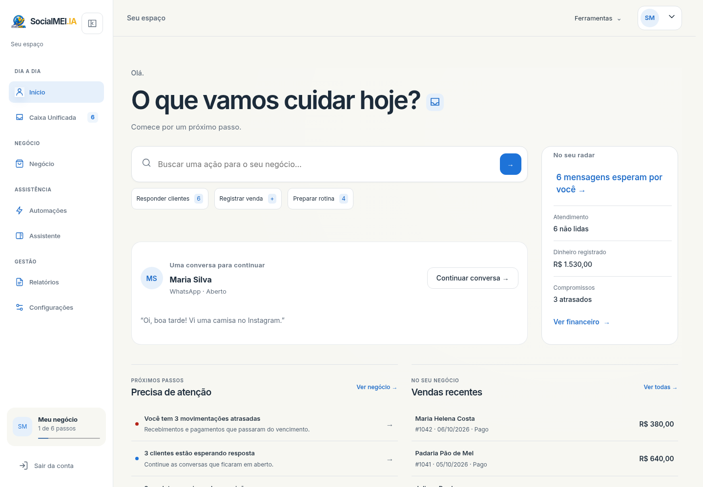
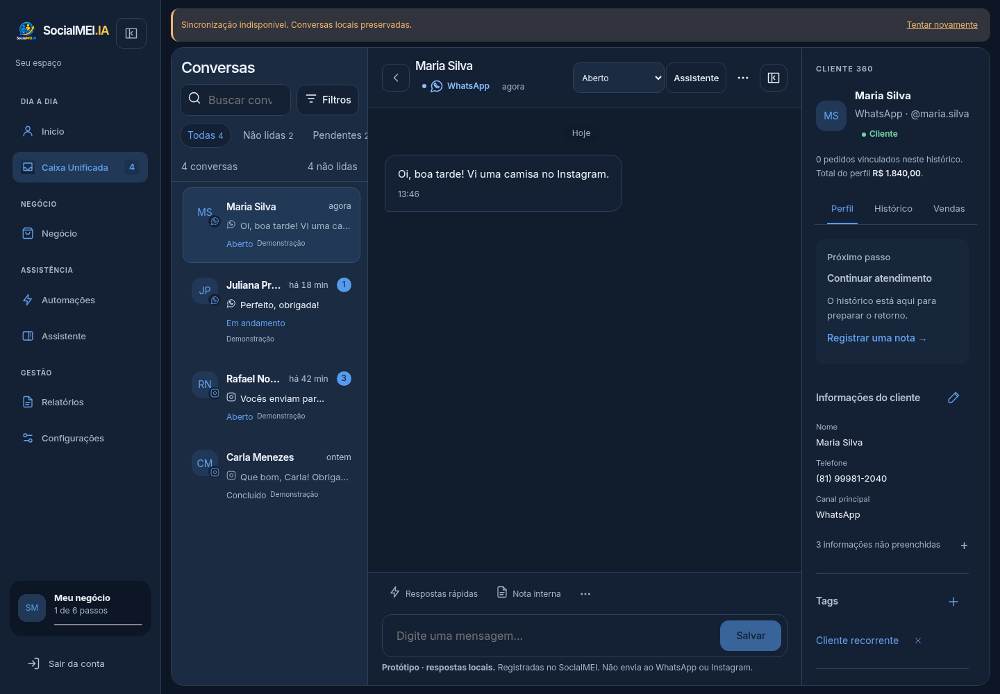
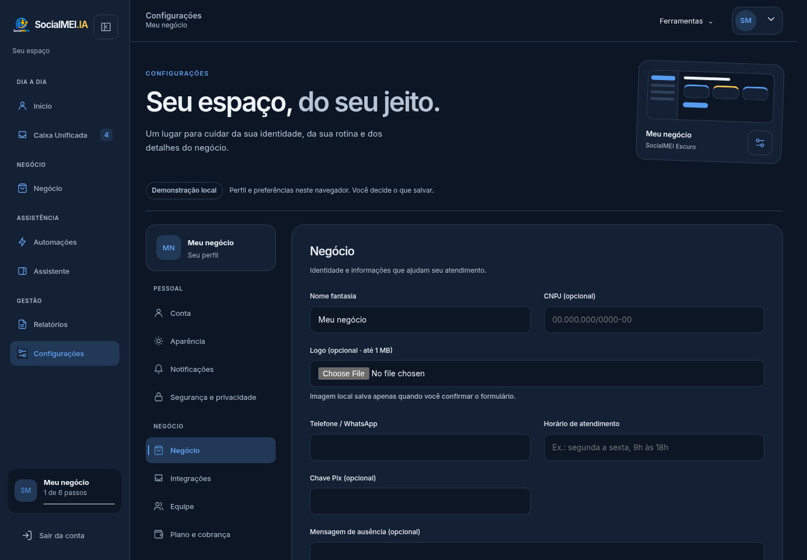
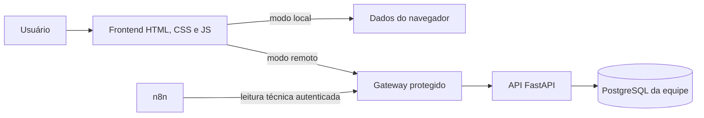

<div align="center">
  

# SocialMEI.IA

### Seu atendimento. Seu negócio. Um só espaço.

CRM experimental para MEIs que reúne clientes, vendas, financeiro<br />
e contexto de atendimento em uma interface feita com HTML, CSS e JavaScript puro.

[](https://github.com/socialmei-ia/SocialMEI-IA/actions/workflows/repository-checks.yml)

[Conheça o produto](#o-que-você-encontra) · [Rodar localmente](#comece-por-aqui) · [Documentação](#guias-para-cada-tarefa) · [Contribuir](CONTRIBUTING.md)

</div>

<br />

<picture>
  <source media="(prefers-color-scheme: dark)" srcset="docs/assets/screenshots/home-dark.png" />
  <source media="(prefers-color-scheme: light)" srcset="docs/assets/screenshots/home-light.png" />
  
</picture>

<p align="center"><sub>Capturas da demonstração local, com dados fictícios. A imagem acompanha o tema do GitHub.</sub></p>

## O que você encontra

A proposta é manter o contexto perto da ação: quem é o cliente, o que foi combinado e o que precisa acontecer depois.

| Área                        | Para que serve                                                                                                           |
| --------------------------- | ------------------------------------------------------------------------------------------------------------------------ |
| **Clientes e catálogo**     | Cadastrar pessoas, produtos e serviços; consultar histórico e organizar informações.                                     |
| **Vendas**                  | Registrar pedidos, acompanhar status e atualizar estoque na operação remota.                                             |
| **Financeiro e relatórios** | Acompanhar entradas, saídas, vencimentos e indicadores; exportar relatórios CSV.                                         |
| **Caixa Unificada**         | Organizar conversas, notas e rascunhos com o contexto do cliente ao lado. O composer ainda não envia mensagens externas. |
| **Assistente e automações** | Preparar sugestões locais e simular regras para revisão do usuário. Sem IA remota ou executor de automações homologados. |
| **Contas e preferências**   | Acesso remoto por convite, sessão revogável e configuração do negócio; temas claro, escuro, automático e personalizado.  |

<details>
<summary><strong>Veja a Caixa Unificada e as Configurações</strong></summary>

### Atendimento com contexto



### Um espaço para ajustar o negócio



Capturas de 14/10/2026, produzidas a partir do frontend `92d4c20`. Dados locais de demonstração; não são registros de clientes reais nem prova do runtime na AWS.

</details>

## Estado do projeto

**Em desenvolvimento, com uso privado da versão da equipe.** A gestão possui API FastAPI, PostgreSQL e autenticação por convite com isolamento de negócio. O modo local continua disponível para demonstração e desenvolvimento.

| Disponível no código                                                                                                          | Depende de configuração ou homologação                                      |
| ----------------------------------------------------------------------------------------------------------------------------- | --------------------------------------------------------------------------- |
| CRUD de clientes, catálogo, vendas e financeiro; modos local/remoto; importação, versões e recuperação de respostas perdidas. | WhatsApp real, Instagram completo e conexão dos canais ao modelo multi-MEI. |
| Contas por convite, cookie de sessão, autorização e proteção Basic adicional no gateway da equipe.                            | Recuperação de senha por e-mail e abertura pública do cadastro.             |
| Rascunhos do Assistente, notas de atendimento e regras simuladas.                                                             | IA remota, envio externo de mensagens e execução real das automações.       |

O nome **SocialMEI.IA** não significa que uma IA remota esteja conectada. Os sete exports n8n versionados estão inativos e não comprovam quais workflows estão publicados no servidor.

## Comece por aqui

**Arquivo principal:** [`frontend/socialmei-app.html`](frontend/socialmei-app.html). Não há build para servir a interface; mantenha HTML, CSS, scripts e assets juntos.

### 1. Abrir a demonstração local

Com Git e Python 3, no PowerShell ou terminal:

```powershell
git clone https://github.com/socialmei-ia/SocialMEI-IA.git
cd SocialMEI-IA
python -m http.server 5500 --bind 127.0.0.1
```

A gestão e as contas usam o modo local da configuração versionada. **Antes de abrir uma demonstração isolada, defina `n8nMessagesUrl: null` na sua cópia local de `frontend/config.js`**, pois o arquivo contém um endpoint legado de leitura. As capturas e os testes desta página bloquearam chamadas externas. Configuração pública nunca deve conter segredos.

Abra **http://localhost:5500**. O `index.html` da raiz encaminha para o frontend principal.

### 2. Desenvolver com banco local

Com Node.js 22+, Python e Docker/Compose; no Windows, deixe o Docker Desktop aberto:

```powershell
npm ci
npm run doctor
npm run setup
npm run dev
```

A preparação cria arquivos locais. Use uma pasta de desenvolvimento; **não execute essa sequência na pasta de produção**. A pilha `compose.dev.yaml` é separada da equipe e do legado. Siga o [guia de entrada da equipe](docs/ONBOARDING.md) para os próximos passos.

## Como o projeto se organiza

**Interface estática · API FastAPI · PostgreSQL 16 · Docker/Compose · Caddy · n8n**



O diagrama mostra os caminhos previstos pelo código, conforme a configuração. Não comprova uma conexão ativa do n8n nem envio para canais. A pilha legada de atendimento é separada; detalhes em [ARCHITECTURE.md](ARCHITECTURE.md).

| Onde procurar                                  | O que fica lá                                                                   |
| ---------------------------------------------- | ------------------------------------------------------------------------------- |
| [`frontend/`](frontend/)                       | Aplicação principal, administração, transferência, scripts e temas.             |
| [`python-service/`](python-service/)           | API, autenticação, autorização e testes Python.                                 |
| [`database/migrations/`](database/migrations/) | Evolução incremental do schema; migrations instaladas não devem ser reescritas. |
| [`n8n-workflows/`](n8n-workflows/)             | Exports operacionais, exemplos e experimentos, classificados por pasta.         |
| [`tools/`](tools/)                             | Preparação local, manutenção, backup, migrador e DevHub.                        |
| [`tests/`](tests/)                             | Testes de frontend, stores, contratos e operação.                               |
| [`docs/`](docs/)                               | Guias, contratos e evidências técnicas datadas.                                 |

Scripts do frontend são clássicos e compartilham estado: preserve a ordem declarada no HTML ao editar. Gestão remota indisponível não deve virar gravação local silenciosa.

## Guias para cada tarefa

| Quero…                                       | Começar por…                                                                                                                        |
| -------------------------------------------- | ----------------------------------------------------------------------------------------------------------------------------------- |
| Preparar meu computador                      | [Entrada da equipe](docs/ONBOARDING.md)                                                                                             |
| Entender como rodar, editar e testar         | [Desenvolvimento](DEVELOPMENT.md)                                                                                                   |
| Entender os componentes e os contratos       | [Arquitetura](ARCHITECTURE.md) · [API](docs/API-ENDPOINTS.md)                                                                       |
| Trabalhar na interface                       | [Design system](docs/DESIGN-SYSTEM.md) · [Validação visual](VISUAL-REDESIGN-REPORT.md) · [Configurações](docs/SETTINGS-REDESIGN.md) |
| Entender contas e permissões                 | [Contas MEI](docs/CONTAS-MEIS.md) · [Acesso de consulta ao banco](docs/TEAM-DATABASE-ACCESS.md)                                     |
| Alterar workflows com segurança              | [Guia do n8n](n8n-workflows/README.md)                                                                                              |
| Fazer deploy ou cuidar da equipe             | [Operação team](docs/OPERACAO-EQUIPE.md) · [Publicação](DEPLOYMENT.md)                                                              |
| Conferir decisões e pendências               | [Revisão da base](PROJECT-BASELINE-REVIEW.md) · [Remediação](docs/REMEDIATION-STATUS.md) · [Roadmap](ROADMAP.md)                    |
| Contribuir ou reportar problema de segurança | [Contribuição](CONTRIBUTING.md) · [Segurança](SECURITY.md)                                                                          |

## Qualidade e testes

O selo no topo mostra o workflow da branch `main`. Consulte o resultado do SHA e os artifacts para saber o que passou; um selo não comprova saúde de produção.

```powershell
npm ci
npm test
npm run format:check
```

<details>
<summary><strong>Testes de navegador, API e operação</strong></summary>

```powershell
npx playwright install chromium
npm run test:browser
node tests/stability-browser.cjs
python -m pip install -r python-service/requirements.txt
python -m unittest discover -s python-service -p "test_*.py"
python -m unittest discover -s tests -p "test_*.py"
```

Testes Python de integração exigem `TEST_DATABASE_URL` apontando **somente para um PostgreSQL descartável**: algumas suites alteram/truncam fixtures. Sem a variável, os casos de banco são ignorados. Gateway e HTTPS exigem Docker e configuração própria, descrita em [DEVELOPMENT.md](DEVELOPMENT.md).

O CI usa PostgreSQL 16, testa gateway, stack team isolada e backup/restore em destino de teste. A matriz de estabilidade cobre 11 resoluções e temas Light/Dark/Auto/Custom. Evidências de navegador ficam no artifact `frontend-regression`.

</details>

## Código, CI e servidor são coisas diferentes

- **GitHub:** fonte, documentação e histórico. Um merge não atualiza automaticamente a AWS.
- **GitHub Pages:** pode servir a demonstração; disponibilidade e configuração devem ser conferidas no repositório.
- **Equipe AWS:** o gateway serve `frontend/socialmei-app.html` em `/`, com configuração privada própria. O `index.html` da raiz do Git não é a entrada servida pelo gateway.
- **Legado:** n8n, WAHA, Caddy e seu banco têm Compose, configuração e volumes próprios. Não misture as pilhas.

Deploy team exige SHA aprovado, backup verificado e atualização restrita ao serviço afetado. Os workflows manuais genéricos de staging/produção não substituem esse procedimento. O [inventário do ambiente](docs/LIVE-ENVIRONMENT-INVENTORY.md) registra coletas anteriores; não é um monitor em tempo real.

<details>
<summary><strong>Registro operacional histórico: 13/10/2026</strong></summary>

O responsável confirmou checkout `ae73f6e…` (PR #35), migration 011 instalada com sete constraints validadas e frontend publicado, com recriação somente do gateway. Login, abertura dos cinco módulos de gestão, saída e reentrada foram confirmados naquele momento.

O perfil de consulta estava preparado, sem provisionamento confirmado na AWS. A role da API foi observada como superuser e requer revisão própria. Consulte [REMEDIATION-STATUS.md](docs/REMEDIATION-STATUS.md) e [TEAM-DATABASE-ACCESS.md](docs/TEAM-DATABASE-ACCESS.md). Esse registro não representa uma nova conferência do servidor.

</details>

## Próximos passos

Conferir permissões do banco e cobertura dos backups; resolver identidade, autorização e idempotência do atendimento antes de conectar canais reais. Evolução de funcionalidades depende das decisões do responsável e dos critérios de aceite.

A revisão de manutenção está proposta no [PR #42](https://github.com/socialmei-ia/SocialMEI-IA/pull/42), separada desta apresentação do repositório. Consulte o estado do PR para verificar se foi integrada.

---

<div align="center">

**SocialMEI.IA** — uma base de trabalho para cuidar do negócio com contexto.

[Roadmap](ROADMAP.md) · [Changelog](CHANGELOG.md) · [Contribuição](CONTRIBUTING.md) · [Segurança](SECURITY.md)

</div>
