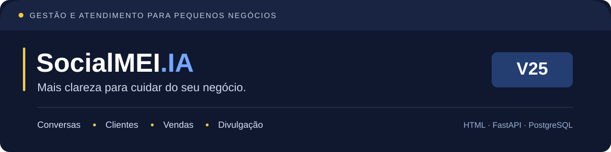
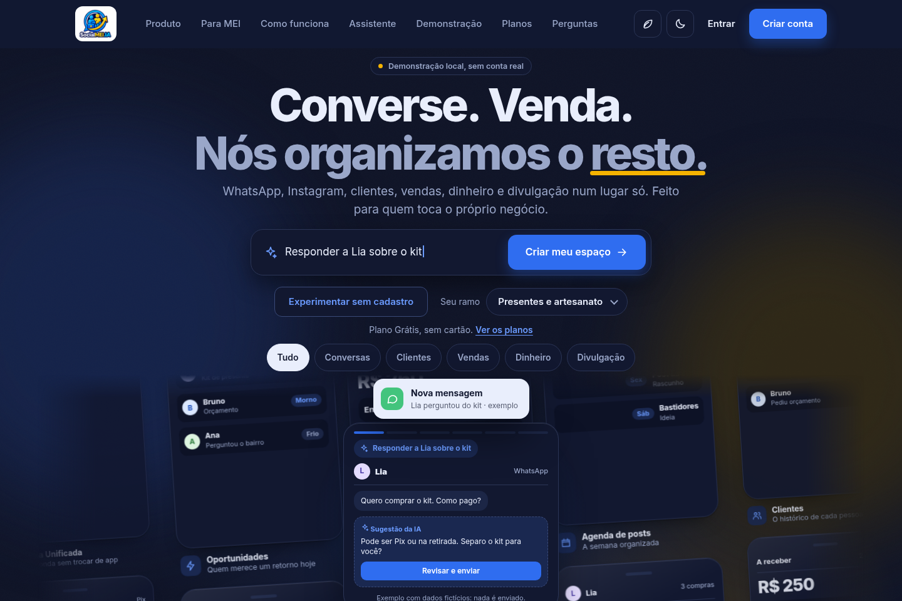
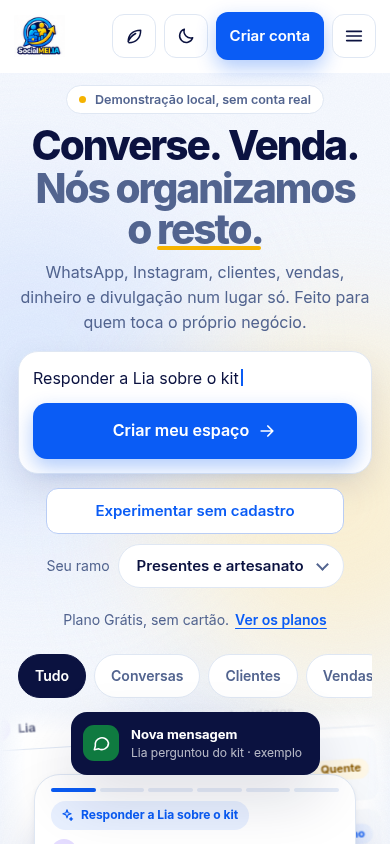
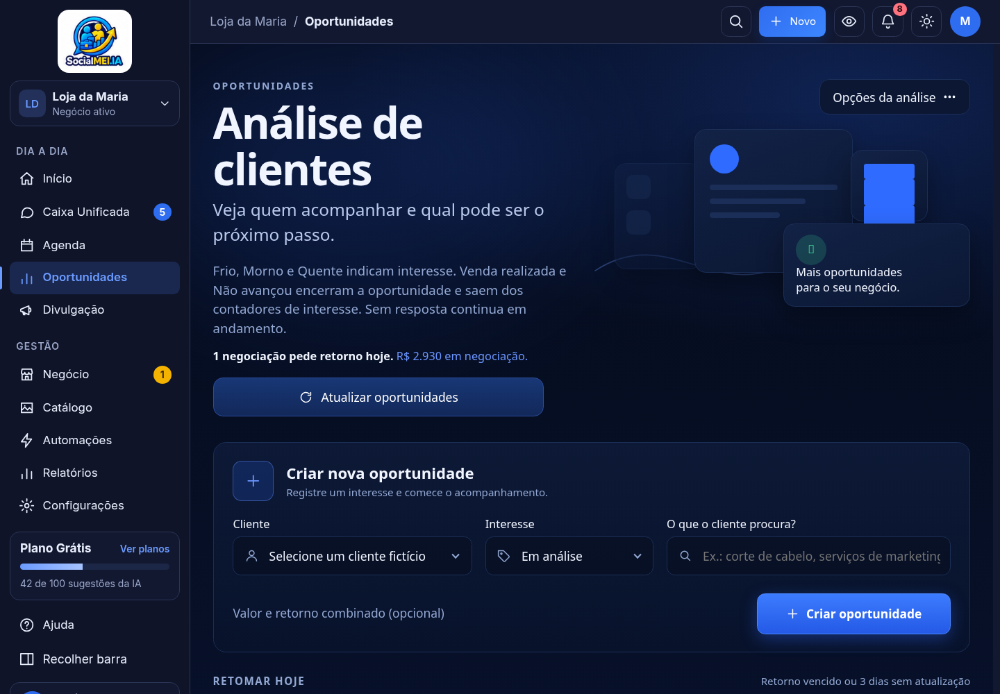
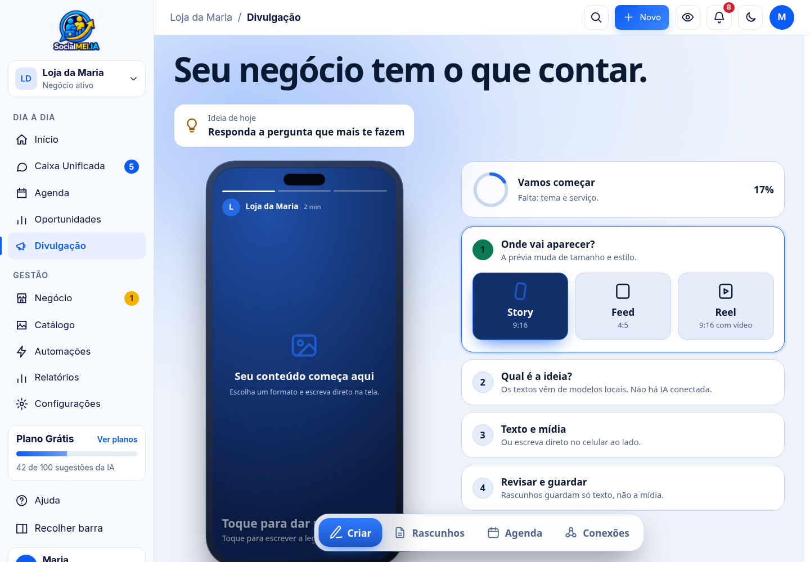
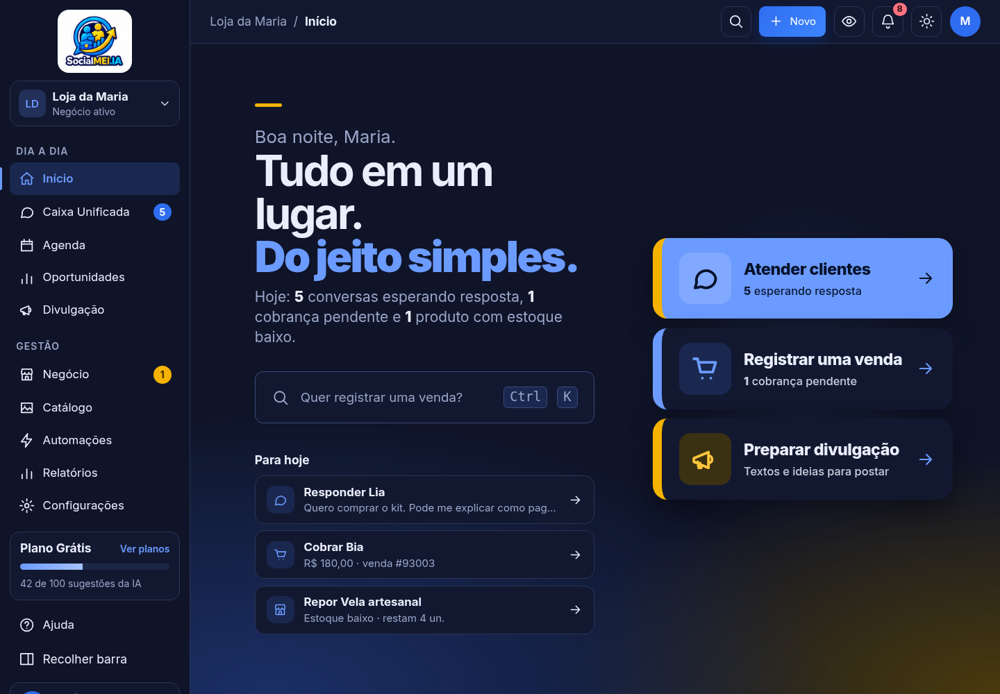

# SocialMEI.IA

**Conversas, clientes, vendas e divulgação. Um lugar para cuidar do seu negócio.**



### [Acessar o SocialMEI na AWS →](https://socialmei-ia.54-94-213-7.sslip.io/)

[Conheça a interface](#conheça-a-interface) · [Versão atual](docs/VERSAO-ATUAL.md) · [Novidades](CHANGELOG.md) · [Links do projeto](#links-do-projeto) · [Desenvolvimento](#começar-a-desenvolver)

O SocialMEI.IA é uma plataforma de gestão e atendimento para MEIs e pequenos negócios. Reúne o dia a dia comercial com uma interface simples, temas claro e escuro e navegação adaptada ao celular.

**A evolução mais recente está nas candidatas [V25 / PR #136](https://github.com/socialmei-ia/SocialMEI-IA/pull/136) e [WhatsApp / PR #137](https://github.com/socialmei-ia/SocialMEI-IA/pull/137).** Elas ainda não foram mescladas à `main`. Esta apresentação reúne o produto atual e as entregas em homologação; código preparado e serviço ativo são identificados separadamente.

## Conheça a interface

### Uma nova entrada para o negócio

A versão V25 preserva a identidade visual aprovada, as animações, o fluxo de entrada e a experiência em telas menores.

[](docs/assets/showcase-v25/entrada-desktop.png)

<details>
<summary>Ver a entrada no celular</summary>

<p align="center">
  
</p>

</details>

### Oportunidades V8

Organize negociações, acompanhe o interesse dos clientes e registre o próximo passo de cada atendimento.

[](docs/assets/showcase-v25/oportunidades.png)

### Divulgação V4

Prepare imagens e legendas, acompanhe a prévia e organize os rascunhos do negócio. A publicação real no Instagram possui uma etapa própria de homologação.

[](docs/assets/showcase-v25/divulgacao.png)

_Capturas da interface atual em ambiente local de demonstração, com dados fictícios. Não representam mensagens recebidas ou posts publicados em contas reais. [Origem das capturas](docs/assets/showcase-v25/source.json)._

<details>
<summary>Ver o painel do negócio</summary>



</details>

## O que já foi construído

- **Contas e CRM:** cadastro, login, sessões seguras e dados separados por negócio. Clientes, catálogo, vendas, estoque e financeiro usam PostgreSQL no modo remoto.
- **Instagram:** conexão OAuth confirmada pelo responsável. Upload com legenda, webhook e Caixa estão implementados; Direct e publicação reais ainda precisam ser comprovados.
- **WhatsApp:** menu persistente, catálogo, encaminhamento humano e controle de tentativas preparados. Pareamento do número e ativação do workflow são a próxima homologação.
- **Documentos PDF:** arquivos privados, extração de texto e busca com documento/página. OCR e respostas geradas por IA ainda não estão implementados.
- **Relatórios:** indicadores de dados reais, CSV e acesso restrito de consulta para colaboradores autorizados.
- **Recuperação de conta:** código temporário de uso único e redefinição segura preparados; SMTP, worker e entrega de e-mail precisam de homologação.

O menu WhatsApp começa com **opções numeradas**. Listas interativas estão preparadas, mas botões no telefone dependem do suporte da engine WAHA e de um teste real. Não há novo envio automático ativo nesta entrega.

[Ver entregas, testes e pendências por versão →](docs/VERSAO-ATUAL.md)

## Últimas entregas

- **V25:** nova entrada fornecida pelo proprietário, com temas, responsividade e integração às contas reais; Oportunidades e Divulgação preservam as referências aprovadas.
- **Instagram:** corrigidos o retorno da autorização, a compatibilidade das permissões e o status de publicação; a conexão OAuth foi confirmada pelo responsável.
- **Backend:** PDFs privados, relatórios com acesso de leitura, recuperação de conta e persistência por negócio preparados e testados.
- **WhatsApp:** receptor configurável por registro privado, menu com catálogo e atendimento humano, credencial específica e reserva de envio que impede repetição da mesma operação.

Na candidata [`e8e0dc8`](https://github.com/socialmei-ia/SocialMEI-IA/commit/e8e0dc8fb677a62d6b1c0b8394882aea6a7da4eb): **513 testes de backend**, **341 testes de frontend** e **864 verificações de banco/restauração** aprovados em ambientes isolados. [CI completo aprovado](https://github.com/socialmei-ia/SocialMEI-IA/actions/runs/40720042774). Esses testes não substituem a homologação com Meta, WAHA ou SMTP reais.

## Começar a desenvolver

Para explorar a candidata mais recente, com Git, Python 3 e Node.js 22+:

```bash
git clone --branch feat/whatsapp-interactive-bot https://github.com/socialmei-ia/SocialMEI-IA.git
cd SocialMEI-IA
npm ci
python -m http.server 5500
```

Abra **http://localhost:5500/frontend/entrada.html**. Esse modo usa a demonstração local e não cria contas reais ou conecta canais externos.

<details>
<summary>Executar o preview isolado com API e PostgreSQL</summary>

Com Docker e Docker Compose disponíveis, na branch candidata:

```bash
npm run preview -- up
```

O comando informa a URL HTTPS local e o estado do ambiente. Use apenas dados de teste e siga as instruções do [preview isolado](https://github.com/socialmei-ia/SocialMEI-IA/blob/e8e0dc8fb677a62d6b1c0b8394882aea6a7da4eb/docs/LOCAL-PREVIEW.md). Esse ambiente não é a AWS e não inicia automações reais.

```bash
npm run preview -- status
npm run preview -- down
```

</details>

<details>
<summary>Arquitetura e verificações</summary>

**Interface:** HTML5, CSS3 e JavaScript Vanilla. **API:** FastAPI/Python. **Dados:** PostgreSQL. **Infraestrutura:** Docker e Caddy. **Orquestração e canais:** n8n, Meta/Instagram e WAHA.

| Caminho                | Responsabilidade                                                   |
| ---------------------- | ------------------------------------------------------------------ |
| `frontend/`            | Interface, temas, autenticação e adaptadores das telas.            |
| `python-service/`      | API, autorização e lógica de negócio.                              |
| `database/migrations/` | Evolução incremental do banco.                                     |
| `n8n-workflows/`       | Exports classificados; não comprovam o estado dos workflows vivos. |
| `tools/` e `tests/`    | Preparação, operação e verificação.                                |

```bash
npm test
npm run format:check
npm run test:browser
```

Testes Python de integração exigem dependências e `TEST_DATABASE_URL` apontando exclusivamente para PostgreSQL descartável. Consulte [Desenvolvimento](DEVELOPMENT.md) e [Contribuição](CONTRIBUTING.md). Nunca executar testes de fixtures no banco de produção.

</details>

## Documentação e colaboração

[Versão atual](docs/VERSAO-ATUAL.md) · [Desenvolvimento](DEVELOPMENT.md) · [Arquitetura](ARCHITECTURE.md) · [Ambientes](docs/ENVIRONMENTS.md) · [Contribuir](CONTRIBUTING.md) · [Segurança](SECURITY.md)

O piloto da equipe está na AWS, com autenticação da aplicação; o gateway público preservado não exige HTTP Basic. Atualizações precisam conservar os overlays privados, os dados e as integrações existentes. Não há publicação automática na AWS ou no GitHub Pages por esta atualização de apresentação.

## Links do projeto

| Destino                 | Acesso                                                                                                                               |
| ----------------------- | ------------------------------------------------------------------------------------------------------------------------------------ |
| **Site na AWS**         | [Abrir o SocialMEI.IA](https://socialmei-ia.54-94-213-7.sslip.io/) — piloto com cadastro/login da aplicação.                         |
| **Código V25**          | [Frontend e integrações consolidadas](https://github.com/socialmei-ia/SocialMEI-IA/tree/feat/frontend-v25-integration).              |
| **Preparação WhatsApp** | [Menu, catálogo e atendimento humano](https://github.com/socialmei-ia/SocialMEI-IA/pull/137).                                        |
| **Instagram**           | [Critérios para concluir Direct e publicação reais](https://github.com/socialmei-ia/SocialMEI-IA/issues/114).                        |
| **Testes da candidata** | [GitHub Actions aprovado](https://github.com/socialmei-ia/SocialMEI-IA/actions/runs/40720042774).                                    |
| **Tarefas e melhorias** | [Issues](https://github.com/socialmei-ia/SocialMEI-IA/issues) · [Pull requests](https://github.com/socialmei-ia/SocialMEI-IA/pulls). |

Ferramentas administrativas, credenciais, tokens e acesso ao banco não fazem parte dos links públicos de apresentação. O link AWS aponta para o ambiente existente; esta atualização não altera sua implantação nem atesta sua disponibilidade em tempo real.
