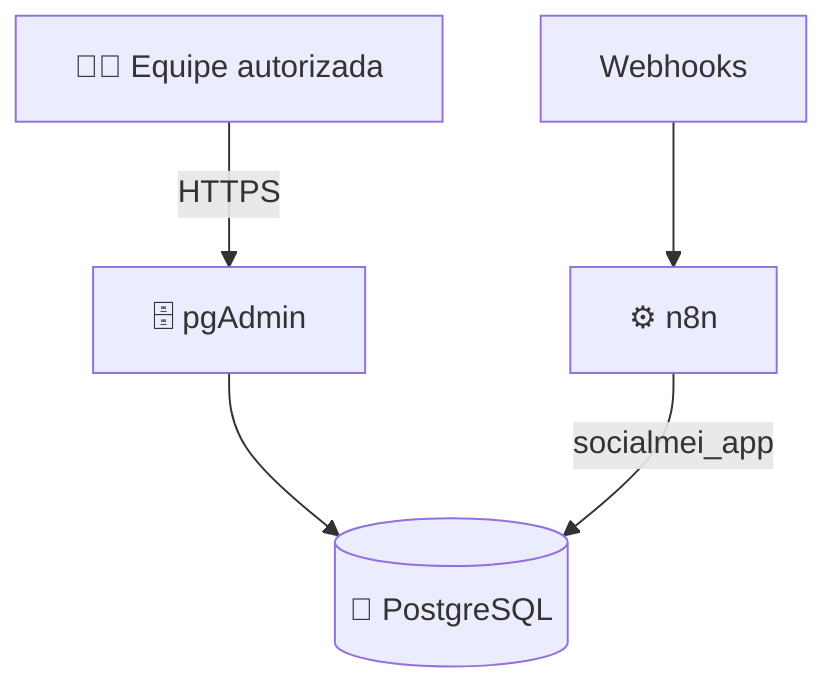

# Banco de dados — SocialMEI.IA

## Objetivo

Este guia descreve o schema versionado e distingue o atendimento legado do banco de gestão/contas. Não substitui inventário datado da VPS. Clientes, Produtos, Vendas e Financeiro têm API/PostgreSQL; Pages/local mantém o demo, enquanto a pilha team usa a API conforme configuração privada.

MEIs acessam seus dados pela aplicação e sua conta, não pelo pgAdmin. pgAdmin/SQL são acessos de manutenção restritos à equipe autorizada. O banco team não depende do notebook de um integrante; o ambiente de desenvolvimento permanece separado.

| Ambiente              | Banco / fonte                                        | Configuração / executor                                                                     |
| --------------------- | ---------------------------------------------------- | ------------------------------------------------------------------------------------------- |
| Pages/demo            | Dados do navegador                                   | `frontend/config.js`, módulos locais; sem conta real no servidor                            |
| Desenvolvimento       | PostgreSQL local, workspace fixo sem auth por padrão | `compose.dev.yaml`; `npm.cmd run db:migrate`                                                |
| Equipe / contas reais | `socialmei_team`, separado do banco n8n              | `compose.team.yaml`, `.env.team` e arquivos privados; migrador team em aplicação controlada |
| Atendimento legado    | Banco n8n e tabelas legadas `socialmei`              | `compose.yaml` e overlays históricos; não misturar com team                                 |

## Arquitetura



A porta 5432 do PostgreSQL continua **sem publicação direta na internet**.

## Estrutura funcional

`database/schema.sql` é referência do atendimento legado:

```text
socialmei
├── clientes
├── conversas
└── mensagens
```

As tabelas internas do n8n permanecem separadas. A família atual da pilha team é definida por `database/migrations/`:

| Migrations | Estrutura / finalidade                                                     |
| ---------- | -------------------------------------------------------------------------- |
| 001        | Referência inicial de atendimento legado                                   |
| 002–004    | `users`, `workspaces`, `workspace_members`, CRM de clientes e importações  |
| 005        | Catálogo e importações                                                     |
| 006        | Vendas, operações e importações                                            |
| 007        | Financeiro, operações e importações                                        |
| 008        | Transferência entre workspaces                                             |
| 009        | Canais, conversas, mensagens e eventos por workspace; não conecta WhatsApp |
| 010        | Credenciais, sessões, convites, limites e auditoria de contas              |

O executor mantém `socialmei.schema_migrations`. As migrations atuais declaram 26 tabelas funcionais; o controle de versões totaliza 27. São estruturas esperadas do Git, não prova dos grants, dados ou runtime atuais. A conferência da equipe em 13/10 registrou 001–010 instaladas; veja [REMEDIATION-STATUS.md](REMEDIATION-STATUS.md) para evidências e limites.

Com autenticação ativada, a sessão e `workspace_members` determinam o negócio autorizado. Sem auth, a API usa o workspace fixo de configuração. Contas da plataforma não criam uma role PostgreSQL por MEI. Senhas são hashes Argon2id; tokens de sessão/convite ficam como hashes no banco, sem valores reais neste guia. Exclusão de Cliente/Catálogo é física quando permitida; Vendas/Financeiro têm exclusão lógica e preservam snapshots.

## Acesso web

pgAdmin:

`https://db.54-94-213-7.sslip.io`

O login é autenticado. Contas humanas devem ser individuais e criadas somente para quem precisar.

Veja também [ACESSOS.md](./ACESSOS.md).

## Roles declaradas no bootstrap legado

| Role              | Uso                                       | Princípio                                                   |
| ----------------- | ----------------------------------------- | ----------------------------------------------------------- |
| `socialmei_admin` | manutenção estrutural do schema funcional | administrativo, uso restrito                                |
| `socialmei_app`   | n8n / automações                          | leitura e escrita funcional sem privilégios administrativos |

As senhas não ficam no GitHub. Esta tabela descreve scripts versionados do legado, não roles/grants observados da VPS. A conexão team usa o usuário configurado privadamente em `.env.team`; permissões efetivas precisam inventário próprio. Nunca conceder acesso SQL a MEIs somente para que possam usar a plataforma.

## Arquivos reproduzíveis

- `database/bootstrap.sql` — prepara o schema com a role administrativa já criada;
- `database/schema.sql` — cria tabelas, índices e restrições;
- `database/permissions.sql` — aplica permissões da role técnica de automação.

Para recriar exclusivamente o bootstrap legado em ambiente **novo e isolado**, crie `socialmei_admin` e defina a senha interativamente (`\password socialmei_admin`) usando um administrador. Aplique bootstrap com administrador, schema como `socialmei_admin` e permissions com administrador. As tabelas precisam pertencer a `socialmei_admin` para que seus default privileges se apliquem às próximas tabelas. Este procedimento não configura contas reais nem substitui o migrador team.

Esses arquivos citam o banco `n8n`; se `POSTGRES_DB` for outro, revise os grants antes de aplicar. O Compose não monta nem executa esses scripts automaticamente. A partir desta fase, novas mudanças estruturais devem entrar em `database/migrations/`.

A primeira migration, `001_initial_socialmei_schema.sql`, representa a estrutura funcional atualmente versionada e é idempotente. Em desenvolvimento local:

```bash
npm run dev
npm run db:status
npm run db:migrate
```

O executor registra versões em `socialmei.schema_migrations` no PostgreSQL local. Ele foi criado para o ambiente de desenvolvimento e **não aplica migrations automaticamente em produção**.

Os arquivos históricos `bootstrap.sql`, `schema.sql` e `permissions.sql` continuam como referência de bootstrap/roles. Novas alterações incrementais devem ser criadas como migrations numeradas:

```text
database/migrations/012_proxima_mudanca.sql
```

Uma migration aplicada nunca deve ser reescrita. Para corrigir algo, crie uma nova migration.

O Git não aplica migrations automaticamente à VPS. A equipe já confirmou a aplicação controlada de 001–010; migrations futuras exigem backup, revisão e autorização próprios. A03/A04/A05/A06 não criam migration nem normalizam dados existentes. Não execute o Compose genérico para atualizar o banco team.

O workflow legado de atendimento insere mensagens sem deduplicação de evento externo e retorna só as últimas 50 mensagens de entrada; não confundir esse contrato com a base 009 preparada. Veja [ARCHITECTURE.md](../ARCHITECTURE.md) e [ROADMAP.md](../ROADMAP.md).

## Saúde e limites do diagnóstico

`/health/db` verifica migrations/colunas do CRM em READ ONLY. Auth ativada exige configuração válida e estrutura 010; ausência produz 503. Auth desativada informa `not_checked`. Canais são capacidade separada: 009 e estrutura presentes → `prepared`; ausência ou leitura estrutural indisponível → `unavailable`. Conexão do provedor fica `not_checked`, sem parear ou consultar WAHA.

Esse diagnóstico não certifica índices, constraints, grants de escrita, contas individuais ou atendimento real. `doctor` consulta o endpoint HTTP de readiness e exige CRM disponível; não cria dados. Um HTTP 200 com persistência desativada é `disabled`, não CRM saudável.

## Alterando a estrutura

Mudanças relevantes devem ficar registradas no GitHub:

```text
branch → SQL/migration → revisão → teste → merge → backup → aplicar
```

Não faça uma mudança estrutural importante apenas pelo painel sem também versionar a alteração.

## Novos integrantes

Não é necessário criar acesso ao banco para todos antecipadamente. Quando alguém precisar:

1. crie uma conta individual no pgAdmin;
2. crie/atribua uma role PostgreSQL com o menor privilégio necessário, se for preciso acesso SQL próprio;
3. nunca compartilhe `socialmei_admin` como login coletivo;
4. documente a finalidade do acesso sem registrar a senha.

## Segurança

- não expor 5432;
- não publicar `.env`;
- não salvar senhas em documentação;
- não usar login administrativo em automações;
- fazer backup antes de migrations destrutivas;
- revisar SQL antes de produção;
- revogar acesso quando deixar de ser necessário.

## Integridade referencial aplicada na estabilização

A migration `011_crm_workspace_links.sql` adiciona sete vínculos compostos por workspace às vendas, financeiro e importações, com três índices únicos de apoio. Preserva referências opcionais e snapshots após exclusão de cliente/produto. Sem RLS: a autorização continua na API; acesso SQL interno exige privilégio específico.

Foi reproduzido em banco descartável que o schema 001–010 aceitava vínculos cruzados por SQL direto, embora a API os recusasse. A 011 rejeita esses vínculos e valida linhas existentes: qualquer inconsistência aborta a transação, sem reparar/apagar dados. Testados upgrade 10→11, replay, histórico, recusa de vínculo cruzado e rollback de upgrade incompatível. Nenhuma migration anterior foi editada.

A aplicação na AWS foi **CONFIRMADA pelo responsável em 13/10/2026**: PostgreSQL 16.15, sete relações sem vínculos incompatíveis no preflight, backup privado de dados/configuração/roles e execução transacional somente do migrador. Registradas versões 001–011 e sete FKs validadas, sem reiniciar API/PostgreSQL. Detalhes em [REMEDIATION-STATUS.md](REMEDIATION-STATUS.md). O `/health/db` existente não é uma certificação dos novos vínculos; conferir migration registrada e constraints validadas em cada ambiente.

O acesso interno de consulta tem procedimento separado em [TEAM-DATABASE-ACCESS.md](TEAM-DATABASE-ACCESS.md). Não usar o script legado do banco n8n nem expor 5432.
