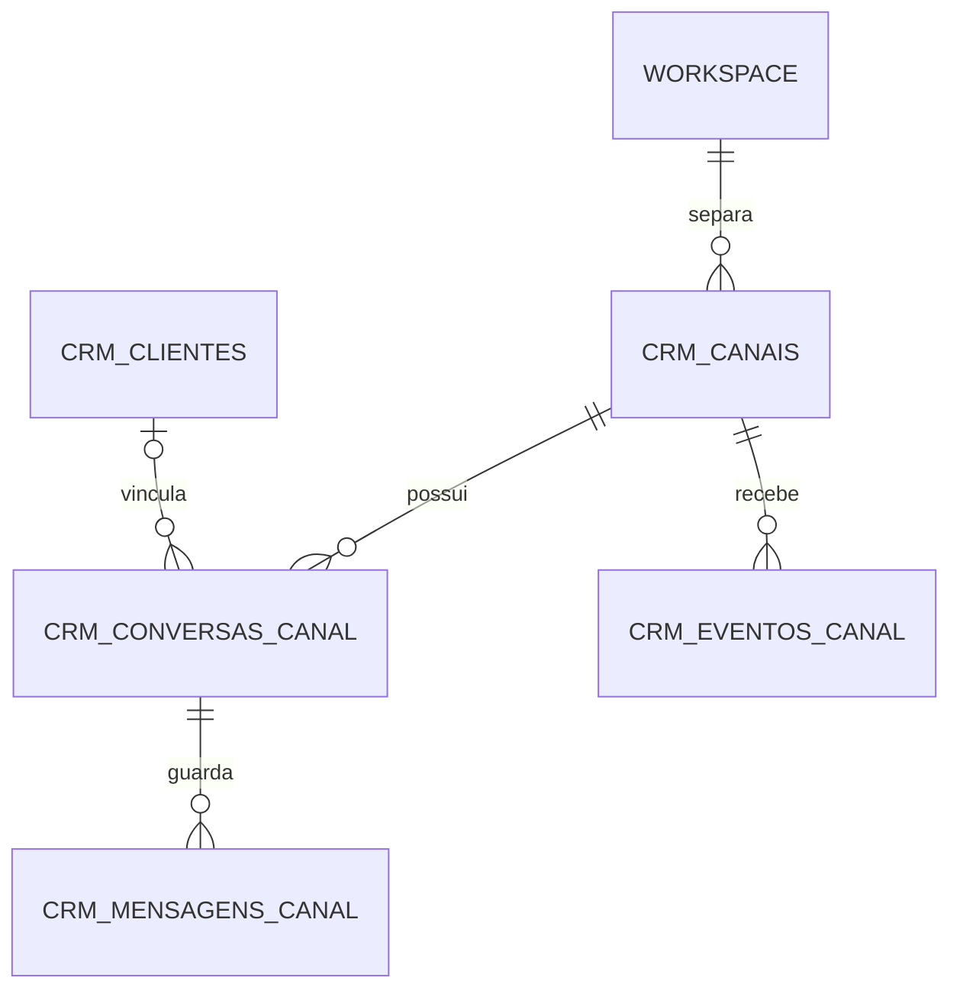

# Banco preparado para atendimento WhatsApp

A migration `009_shared_channel_foundation.sql` prepara o PostgreSQL da equipe para atendimento por WhatsApp/WAHA. Ela cria tabelas vazias e um índice de vínculo no cadastro de clientes. Aplicar a migration não conecta um número, não cadastra uma sessão, não ativa webhook e não envia mensagens. A conexão continua aguardando o chip dedicado.

## Estrutura

| Tabela                | Finalidade                                                                                                            |
| --------------------- | --------------------------------------------------------------------------------------------------------------------- |
| `crm_canais`          | Instância WAHA, sessão, workspace, estado observado e permissões locais. `ativo` e `envio_habilitado` começam falsos. |
| `crm_conversas_canal` | Conversa identificada pelo ID externo dentro do canal; vínculo opcional e explícito ao cliente do mesmo workspace.    |
| `crm_mensagens_canal` | Histórico de entradas/saídas, texto ou referência privada de mídia, IDs externos, identidade de envio e confirmações. |
| `crm_eventos_canal`   | Eventos normalizados, chave de deduplicação, fingerprint, resultado e tentativas de processamento.                    |



As tabelas antigas `clientes`, `conversas` e `mensagens` continuam intactas. Elas não são copiadas automaticamente porque os identificadores antigos não oferecem uma associação segura aos novos canais/workspaces. Também não se transforma uma conversa de demonstração do navegador em atendimento real.

## Identidade e integridade

- A instância é um alias interno estável, como `waha-principal`, sem URL, senha ou token. Uma combinação provedor/instância/sessão só pode pertencer a um workspace.
- IDs de conversa/mensagem são opacos e sensíveis à caixa das letras. Preserve o valor completo recebido do provedor; nome e telefone exibidos não são identidade. A equivalência entre JIDs telefônicos e LIDs exige mapeamento confirmado pelo provedor.
- Uma conversa não pode usar um canal ou cliente de outro workspace. Um grupo não é vinculado a um único cliente. Ao excluir um cliente, apenas seu vínculo é removido; a conversa e suas mensagens permanecem.
- IDs externos de mensagem são únicos por canal, inclusive entre conversas. A mesma identificação em dois canais diferentes é permitida. Um reenvio de `message`/`message.any` não deve virar outra mensagem.
- Uma saída criada pelo app exige `operation_id` UUID e `operation_fingerprint`. Repetições devem recuperar a operação existente somente quando a fingerprint coincidir; dados diferentes com o mesmo UUID são conflito. O adaptador ainda precisa implementar essa comparação transacional.
- Saídas observadas pelo WAHA, feitas pelo próprio telefone, podem não ter operação do app. Elas precisam de ID externo e confirmação de envio; `fromMe` não significa que o CRM enviou a mensagem.
- `ocorrida_em` pode ficar nula se a origem não informou o horário. `criado_em`/`recebido_em` registram a persistência; não substituem uma data externa desconhecida. Use `TIMESTAMPTZ` e apresente no fuso do app.

As constraints impedem vínculos cruzados, duplicações e estados incompletos. Elas não substituem autenticação, autorização ou validação do adaptador. Alterações futuras devem incrementar `versao`/`atualizado_em` e exigir a versão esperada quando houver edição humana.

## Recebimento futuro

1. Validar autenticação/assinatura do webhook e o limite do corpo antes de ler/gravar dados. Resolver o canal pela configuração do servidor; o payload não escolhe o workspace.
2. Normalizar por allowlist os campos necessários. Nunca guardar headers de autorização, API keys, QR, configuração da sessão ou `_data` completo em `dados_normalizados`.
3. Usar o ID estável do envelope quando disponível para a chave do evento. Quando ausente, definir uma chave semântica estável pela versão/evento/ID da mensagem e estado específico; texto igual não basta para deduplicar. ACKs diferentes da mesma mensagem devem ter chaves diferentes.
4. Em uma transação, registrar/recuperar o evento, conferir sua fingerprint, inserir/recuperar a conversa e a mensagem e marcar o evento processado. Só reconhecer o webhook depois do commit. Um erro não pode deixar contadores ou mensagens parciais.
5. ACKs podem chegar antes da mensagem: preservar `mensagem_externa_id` com `mensagem_id` nulo e reconciliar depois. Eventos fora de ordem não podem fazer `lida` regredir para `enviada`.

`crm_eventos_canal.dados_normalizados` aceita um objeto JSON de até 2 MB; o endpoint futuro também deve limitar o corpo bruto. `codigo_erro` é um código sanitizado, não a saída completa do provedor com dados pessoais ou credenciais.

## Envio futuro

`rascunho` → `pendente` → `enviada` → `entregue` → `lida` descreve o caminho normal. `falha`, `incerta` e `cancelada` guardam outros resultados. O banco valida campos necessários, mas não executa uma máquina de estados ou uma fila.

O executor futuro deve verificar permissão humana, canal ativo, envio habilitado e saúde real da sessão antes de chamar WAHA. Ter uma linha `pendente` não autoriza envio. Timeout depois da chamada deve ficar `incerta`, com conciliação pelo ID/operação; não fazer retry automático que possa duplicar a mensagem. Criar uma nova identidade para repetir uma chamada incerta também pode duplicar o envio.

Mídias devem ficar em armazenamento privado com referência opaca em `midia_ref`, MIME validado e acesso autorizado. Não guardar blobs, URLs temporárias com credenciais ou depender de links efêmeros do WAHA como backup.

## Aplicação

Após revisão/merge e atualização do checkout, no desenvolvimento:

```powershell
npm.cmd run db:migrate
npm.cmd run db:status
```

No servidor da equipe, use o procedimento de atualização próprio, faça backup antes e aplique a migration no banco da equipe:

```bash
cd /home/ubuntu/socialmei-team
python3 tools/team-maintenance.py backup
docker compose --env-file .env.team -f compose.team.yaml run --rm --no-deps team-migrate
python3 tools/team-maintenance.py doctor
python3 tools/team-maintenance.py backup
```

Não combine os Composes da equipe/legado/desenvolvimento nem execute o bootstrap antigo para aplicar esta migration. Não altere o banco n8n, as credenciais ou os volumes WAHA nesta etapa.

O `pg_dump` da equipe inclui as tabelas novas. O CI testa constraints, replay da migration, rollback de uma gravação inválida, concorrência e restauração de uma mensagem fictícia. A exportação/transferência inicial do notebook continua abrangendo somente os quatro módulos de gestão; não transfere esse novo histórico de atendimento.

Rollback do código não exige apagar tabelas. Preserve o schema e os dados; desligue o adaptador se ele tiver sido instalado em uma etapa posterior. Não remova a versão da migration nem restaure produção automaticamente para desfazer uma atualização aditiva.

## Próximas etapas

### Contas dos MEIs e administrador do projeto

Requisito confirmado: cada MEI precisa de uma conta persistida e acesso apenas ao seu negócio; a conta do responsável pelo projeto precisa de administração. `users` e `workspace_members` já existem como fundação, mas ainda não implementam autenticação. Nenhum usuário ganha permissão administrativa ao aplicar esta migration.

A próxima entrega de autenticação precisa incluir hash de senha, sessões revogáveis, vínculo usuário/workspace e autorização no servidor. O administrador do projeto deve ser criado explicitamente por procedimento privado; ele é diferente do papel `admin` de um único negócio. Cadastro público não pode aceitar flags de administrador, papel ou workspace enviados pelo navegador. Cookies/sessões e seu eventual período de permanência precisam ser definidos nesse contrato; não guardar senha ou conceder acesso por um login apenas visual.

As quatro rotas humanas de gestão atuais escolhem o workspace pelo ambiente do servidor. Antes de liberar acesso aos MEIs, devem resolver o workspace a partir da sessão autenticada e validar a associação. Separar linhas por workspace no banco, por si só, não torna o site um produto com isolamento por usuário. A proteção atual do servidor continua até essa entrega ser validada e a abertura do acesso ser decidida com o dono.

A API autenticada de atendimento, o adaptador WAHA/n8n e a Caixa Unificada compartilhada serão etapas próprias. A credencial técnica instalada atualmente continua restrita à leitura dos quatro módulos de gestão; não recebe nova permissão de escrita ou acesso ao histórico por esta migration. Regras de orçamento, preço, medidas, frete e aprovação precisam ser definidas antes de calcular/enviar um orçamento real.

Referências de contrato: [sessões WAHA](https://waha.devlike.pro/docs/how-to/sessions/), [recebimento](https://waha.devlike.pro/docs/how-to/receive-messages/), [eventos/ACKs](https://waha.devlike.pro/docs/how-to/events/) e [constraints PostgreSQL 16](https://www.postgresql.org/docs/16/ddl-constraints.html). A compatibilidade do payload deve ser conferida com a versão realmente instalada quando o chip chegar.
