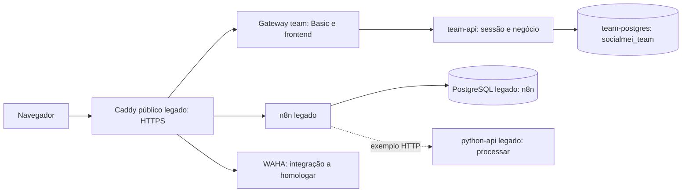

# Ambientes e fontes de verdade

Revisão de 14/10/2026, America/Fortaleza. Código e configuração foram conferidos no checkout. Evidências da AWS abaixo foram fornecidas pelo responsável na conversa; não representam uma nova conexão SSH. Quando faltar evidência, o estado é **NÃO CONFIRMADO**.

## Onde estou trabalhando?

| Ambiente                    | Objetivo e dados                                                 | Frontend / API / banco                                                                                         | Configuração e operação                                                                 | Estado                                                                                  |
| --------------------------- | ---------------------------------------------------------------- | -------------------------------------------------------------------------------------------------------------- | --------------------------------------------------------------------------------------- | --------------------------------------------------------------------------------------- |
| Navegador local, sem Docker | UI e demonstração; dados fictícios no navegador                  | `frontend/socialmei-app.html`; sem API de gestão obrigatória; localStorage                                     | Servidor estático; `frontend/config.js` público                                         | Regressão local automatizada; não é conta remota                                        |
| Desenvolvimento Docker      | Integração por integrante, sem dados de clientes reais           | Frontend em `localhost:5500`; API em `localhost:8000`; PostgreSQL em `localhost:5433`; n8n em `localhost:5678` | `compose.dev.yaml`, `.env.development`; pgAdmin/WAHA opcionais por profile              | Definição versionada; execução completa em cada notebook deve ser validada              |
| CI                          | Testar PR/commit em recursos descartáveis                        | PostgreSQL de testes, navegador, gateway e stack team isolados                                                 | `.github/workflows/repository-checks.yml`; fixtures e credenciais de teste              | Executa testes; não publica o site ou a AWS                                             |
| GitHub Pages                | Demonstração estática, se habilitada                             | Entrada `index.html` → frontend; sem FastAPI/PostgreSQL próprios                                               | Settings → Pages; URL prevista `https://socialmei-ia.github.io/SocialMEI-IA/`           | Habilitação e configuração remotas **NÃO CONFIRMADAS**                                  |
| Team / piloto na AWS        | Uso compartilhado com contas individuais e dados de negócio      | Gateway team → `team-api` → `team-postgres`; schema `socialmei`                                                | `/home/ubuntu/socialmei-team`, `compose.team.yaml`, `.env.team`, `deploy/team/private/` | Existência e uso confirmados pelo responsável; sem inspeção direta nesta rodada         |
| Pilha legada na mesma AWS   | n8n, API auxiliar, WAHA, PostgreSQL n8n, Caddy público e pgAdmin | `socialmei-n8n`, `socialmei-python`, `socialmei-postgres` e demais serviços legados                            | `/home/ubuntu/socialmei`, `compose.yaml`, override efetivo e `.env` privados            | Ainda necessária; possui alterações locais relatadas; não substituir pelo checkout team |
| Staging                     | Homologação compartilhada futura, isolada do piloto              | Host, banco, URLs e credenciais próprios a definir                                                             | Existe workflow manual genérico; não há instalação comprovada                           | **PLANEJADO / NÃO CONFIRMADO**; [proposta](STAGING.md)                                  |

Não há evidência de outro ambiente de produção separado do piloto team. O nome `production` de um GitHub Environment ou a pasta `n8n-workflows/producao/` não comprova uma implantação.

## AWS: dois projetos, uma borda pública

O Caddy interno usa HTTP na rede Docker; o TLS público fica na borda. Basic libera o ambiente, não substitui a sessão individual nem seleciona um negócio. Não compartilhar senha de banco para abrir o site.

| Serviço      | Endereço conhecido                                                                                        | Dados / segredos                                                   | Teste permitido nesta revisão                            |
| ------------ | --------------------------------------------------------------------------------------------------------- | ------------------------------------------------------------------ | -------------------------------------------------------- |
| Site team    | `https://socialmei-ia.54-94-213-7.sslip.io/`                                                              | Contas/CRM no banco team; Basic e configuração privada no servidor | Fixtures locais e CI; acesso real depende do responsável |
| n8n          | `https://socialmei.54-94-213-7.sslip.io/`                                                                 | Banco n8n, volume e chave de criptografia originais                | Exports estáticos; não chamar webhooks vivos             |
| API auxiliar | `http://python-api:8000` dentro de `socialmei_default`; host público histórico `api.54-94-213-7.sslip.io` | `/processar` não é API do CRM                                      | Contratos locais; não enviar dados pessoais              |
| WAHA         | `https://waha.54-94-213-7.sslip.io/dashboard`                                                             | Sessões, API key e dashboard privados                              | Sem QR, pareamento, reinício de sessão ou envio          |
| pgAdmin      | `https://db.54-94-213-7.sslip.io`                                                                         | Credenciais privadas; disponibilidade atual não reconfirmada       | Sem acesso nesta rodada                                  |

URLs internas Docker não abrem diretamente no notebook. `127.0.0.1` em um container aponta para aquele container, não para a AWS ou outro serviço.

## O que foi efetivamente relatado

- Frontend team: imagem `socialmei-phone-mask/team-gateway:92d4c20a106d330a24452f6cca969c79762c15b3`; API team: imagem `socialmei-contacts/team-api:5006b2e38de3865fd070cc67c48a55e703ef3291`. São versões distintas; checkout do host não certifica o conteúdo de ambas.
- Migrations 001–011 e sete relações por workspace foram confirmadas pelo responsável. A role `socialmei_team` foi observada com superuser; redução de privilégios continua uma etapa própria.
- A credencial Basic compartilhada de avaliação foi adicionada e testada pelo responsável com backup privado. Ela é independente das contas do aplicativo. Esta revisão não altera esse acesso.
- n8n 2.40.5 e WAHA 2026.9.2/WEBJS foram observados anteriormente. A preparação de executor Python foi relatada; configuração final e execução ponta a ponta não foram reconfirmadas nesta revisão.
- A API auxiliar foi conferida pelo responsável: imagem `socialmei-python-api`, sem mounts, rede `socialmei_default`, `/health` e `/processar` presentes; `/mensagem` e `/estoque` ausentes. O protótipo do PR #45 é trabalho separado, não incorporado aqui.
- O backup privado da API auxiliar foi conferido pelo responsável. Não há evidência de publicação da nova API de planilha ou de restore ensaiado. Não retomar uma publicação antiga sem nova revalidação.

Os inventários de [13/10](LIVE-ENVIRONMENT-INVENTORY.md) e [remediação](REMEDIATION-STATUS.md) permanecem evidências datadas; não apagá-los para fazer parecer que houve coleta recente.

## Configuração pública, privada e testes

| Local                                                  | Conteúdo / consumidor                                       | Regra                                                                                              |
| ------------------------------------------------------ | ----------------------------------------------------------- | -------------------------------------------------------------------------------------------------- |
| `frontend/config.js`                                   | URLs e modos públicos dos stores; vem do Git no demo        | Nunca inserir senha, chave n8n, credencial Basic ou token administrativo                           |
| `deploy/team/private/config.js`                        | Configuração pública de modo remoto servida pelo mount team | O arquivo é privado na distribuição, mas seu conteúdo chega ao navegador; não pode conter segredos |
| `.env.development`                                     | Serviços Docker locais e ferramentas `tools/`               | Só desenvolvimento; criado a partir do exemplo; não versionar                                      |
| `.env.team`                                            | Banco, auth, token técnico, host team                       | Somente servidor autorizado; backups privados                                                      |
| `.env` legado                                          | n8n, PostgreSQL legado, WAHA e Caddy                        | Não misturar com `.env.team`; preservar `N8N_ENCRYPTION_KEY`                                       |
| `deploy/team/private/*.Caddyfile` e overrides privados | Gateway/roteamento e hashes de Basic                        | Não imprimir, versionar ou distribuir no grupo                                                     |
| `TEST_DATABASE_URL`                                    | Suites Python que alteram fixtures                          | Somente PostgreSQL descartável; nunca apontar para AWS ou banco de trabalho                        |

`compose.team-proxy.yaml` é overlay do Caddy legado, ligando-o à rede team existente. Não é um segundo Compose team completo. Overlays locais não versionados podem existir; os labels do container indicam os arquivos usados quando ele foi criado. Não imprimir `docker compose config` completo: pode resolver e expor segredos. Para validação, usar `--quiet`.

## Publicação e rollback

CI verde, merge e build não são deploy. Para atualizar o piloto, conferir checkout limpo, containers/imagens efetivos, backup e configuração privada; preparar imagem identificada pelo SHA; validar; recriar somente o serviço autorizado com dependências preservadas. Migrations, se necessárias, têm etapa explícita. O rollback usa imagem e configuração anteriores; não restaura banco automaticamente. Procedimento em [DEPLOYMENT.md](../DEPLOYMENT.md).

Os workflows manuais existentes executam o Compose genérico. Não usá-los para validar/publicar team nem assumir que environments, SSH, reviewers ou proteção de branch estejam configurados. Estes estados administrativos são **NÃO CONFIRMADOS**.
