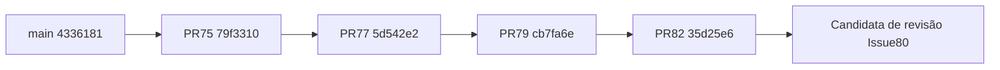

# Candidata de integração — Issues #80/#81

## Parecer e limite desta entrega

Esta é uma candidata **à revisão**, não uma publicação autorizada. O HEAD final, os resultados dos checks e os artefatos ficam registrados na PR Draft de integração. Resultado pendente não significa teste aprovado. A rodada acrescenta documentação, ensaio descartável e diagnóstico das regressões de navegador; preserva funcionalidades e contratos, com correções pontuais de foco da Caixa e preservação da revisão do perfil local comprovadas por testes. Não modifica autenticação, migrations aplicadas, configuração de implantação ou branches anteriores.

**Publicação: NEEDS DECISION.** Staging instalado é **NÃO CONFIRMADO**. Merge, implantação, migrations reais, canais e operações externas continuam bloqueados até autorizações específicas. Nenhum SSH, AWS, n8n, WAHA, Meta ou banco real foi acessado.

## Histórico congelado e estratégia de revisão

| Referência | HEAD conferido                             | Commits acrescentados ao elo anterior             |
| ---------- | ------------------------------------------ | ------------------------------------------------- |
| main       | `4336181fc9156d386cc46158ced708b6efda7be5` | baseline                                          |
| #75        | `79f33107b0d441c9b0d91cacbde8ebc8cbf93bda` | 43 sobre main, incluindo merges #69→#70→#71 e #74 |
| #77        | `5d542e2fa675519d99bfcfea5bc899a7225ed885` | 12                                                |
| #79        | `cb7fa6efcf7fc48b1b676af86d2929330c5c4995` | 6                                                 |
| #82        | `35d25e6c255eb85d6fb0596773fa355d6f03029f` | 5                                                 |

Branch `release/integration-candidate-80`, criada exatamente do HEAD #82. A ancestralidade de todos os elos foi conferida com `git merge-base --is-ancestor`; nenhum cherry-pick, rebase ou force-push. O diff contra main inclui a cadeia completa; o diff exclusivo desta rodada começa em `35d25e6`.



### Merge proposto — não executado

1. Revisar esta PR única e seus commits herdados; confirmar que nenhum HEAD de origem mudou. Reexecutar o CI se houver alteração ou conflito com main.
2. Após aprovação específica, integrar **somente esta candidata**, preferindo merge commit que preserve ancestralidade. Não integrar novamente cada ancestral nem aplicar cherry-picks. Se a política exigir squash/rebase, decidir explicitamente a reconciliação; não reescrever branches publicadas nesta preparação.
3. Conferir no novo main que os HEADs #75/#77/#79/#82 são ancestrais e que os testes correspondem ao resultado integrado. Se GitHub não reconciliar as PRs automaticamente, fechá-las como incorporadas, com link para a integração, somente após autorização e essa conferência. Não somar merges independentes para fechar a lista.
4. #72 é documentação/Skill separada e não foi incorporada. #73 permanece aberta: o timeout histórico de Financeiro continua sem causa confirmada; CI verde não o resolve. Issues #76/#78/#81 têm entregas herdadas, sem fechamento automático por esta PR.

## Inventário funcional consolidado

| Área                                 | Funcionamento verificável                                                                                                         | Limite preservado                                                                                             |
| ------------------------------------ | --------------------------------------------------------------------------------------------------------------------------------- | ------------------------------------------------------------------------------------------------------------- |
| Gestão, Financeiro e Relatórios V2.1 | Registros pelos contratos suportados, cálculos, filtros, CSV/PDF, estados vazios e isolamento                                     | Histórico de relatórios local, sem sincronização remota; métricas sem fonte válida indisponíveis              |
| Onboarding, Home e catálogo          | Perfil adaptativo e sugestões; perfil autenticado por workspace, preferências essenciais por usuário/workspace                    | Importação local só com revisão/confirmação; sem fila offline persistente, tempo real ou mesclagem automática |
| Divulgação / Instagram               | Editor e simulação autenticada de metadados, papéis e idempotência                                                                | Desabilitados por padrão; sem upload, publicação, worker ou ligação n8n/Meta                                  |
| Caixa / Message Enrichment           | Laboratório sintético autenticado, sentimento heurístico, consulta lexical a texto próprio, fontes e revisão persistida sem envio | Desabilitado por padrão; sem conector real, LLM, PDF/embeddings, envio ou sincronização contínua              |
| RAG / callback interno               | Escopo por job persistido, HMAC, replay, TTL, retry limitado, quota e CAS testados                                                | Somente stub; namespace interno não é encaminhado pelo gateway público; nenhuma ligação viva instalada        |
| Automações / Agenda / entregas       | Rotinas locais e recursos existentes identificados na interface                                                                   | Testar rotina não executa workflow externo; módulos futuros não são integrações disponíveis                   |

Documentos canônicos: [QA76](QA-76-FUNCTIONAL-AUDIT.md), [QA78](QA-78-PROFILE-SYNC.md), [QA81](QA-81-MESSAGE-ENRICHMENT.md), [contrato de perfil](PROFILE-SYNC-API.md) e [contrato de enriquecimento](MESSAGE-ENRICHMENT-CONTRACT.md).

## Configuração e limites de segurança conferidos

- `frontend/config.js` é público: `n8nMessagesUrl`/`n8nAuthHeader` nulos, `instagramPublisher.mode` e `instagramSimulation.mode` em `disabled`; modo de gestão local por padrão. Não inserir tokens, senhas ou chaves nesse arquivo.
- `deploy/team/private/config.js` é mount privado **mas seu conteúdo chega ao navegador**. O arquivo privado efetivo não foi aberto ou impresso; URLs/modos devem ser conferidos pelo operador autorizado antes de publicar. Não substituir o mount pela configuração de demonstração.
- Backend Instagram usa `SOCIALMEI_INSTAGRAM_MODE`, padrão `disabled`; somente `simulation` habilita o contrato sintético. Message Enrichment usa `SOCIALMEI_MESSAGE_ENRICHMENT_MODE=disabled` por padrão; `stub` exige chave de teste exclusiva no servidor. Não habilitar nenhuma opção nesta implantação proposta. O Compose versionado não repassa essas flags opt-in; overrides efetivos ainda precisam de inspeção autorizada.
- Basic do gateway e sessão individual são controles distintos. Gateway retira Authorization das rotas humanas; token técnico atende somente GETs explicitamente autorizados. API preserva sessão, Origin, CSRF, papéis e workspace derivado no servidor. Não reativar endpoint legado nem importar dados locais automaticamente.
- PostgreSQL team não publica porta; redes de API/banco são internas. O callback `/internal/message-enrichment/results` não é roteado pelo Caddy team atual. Headers incluem `no-store`, `nosniff` e `Referrer-Policy`. Esses são fatos do código; instalação, privilégios reais e overrides atuais não foram reconfirmados na AWS.
- Workflows `manual-production-deploy.yml` e `manual-staging-deploy.yml` usam Compose genérico. **Não são o procedimento team** e não foram executados. Proteções de branch, secrets, reviewers e staging remoto não são comprovados pela existência dos YAMLs.

## Ensaio de migrations e recuperação

O ensaio opt-in `tests/release-candidate-db.py` usa seu próprio PostgreSQL 16 descartável, dados fictícios e dump custom. Não aceita URL de banco do operador, não reutiliza serviço instalado e remove somente seus recursos. Requer Docker Linux pelo socket local e as dependências Python do backend. Executar somente em desenvolvimento/CI, nunca no servidor real:

```bash
python tests/release-candidate-db.py --run --output test-results/release-candidate --backend-tests
```

No CI, a suíte backend já roda separadamente e o ensaio omite `--backend-tests`. O artefato `release-candidate-readiness` contém apenas JSON sanitizado; dump e configuração privada não são publicados. Isso não executa rollback de imagens: testa a preservação do esquema/dados e os defaults, enquanto a troca de imagens permanece um plano.

| Migração | Mudança aditiva                                         | Verificação exigida                                                                               |
| -------- | ------------------------------------------------------- | ------------------------------------------------------------------------------------------------- |
| 012      | contas e publicações Instagram exclusivamente simuladas | upgrade sobre 001–011 com dados; estados restritos a `simulated`, FKs por workspace, sem ativação |
| 013      | `workspace_profiles` e `auth_preferences`               | perfil por negócio, preferências por membro, revisões e preservação do legado                     |
| 014      | conversas/mensagens/jobs/documentos/eventos sintéticos  | identidade composta, integridade, deduplicação e restauração dos registros escopados              |

O mecanismo `tools/team_migrate.py` aplica pendências numa transação com advisory lock e ledger de nomes. Não armazena checksum dos SQLs: a comparação Git/hash da cópia revisada é obrigatória antes de publicação; não editar migrations já aplicadas. Um ledger inesperado bloqueia a operação, não autoriza apagar/recriar o schema.

O ensaio deve provar atualização incremental, reaplicação sem duplicação, preservação de dados anteriores, dump/índice/restore com comparação de conteúdo, relações e ledger. O teste não comprova tempo de lock, espaço livre, extensões/permissões ou recuperação do banco real. Números e saídas finais acompanham a PR; não confundir backup sintético com backup disponível na AWS.

### Evidência local desta rodada

Node: **284 testes aprovados**; backend: **194 testes aprovados sem skips**, em outro banco do mesmo container descartável. Ensaio final: **34 verificações aprovadas**, comparando as 40 tabelas, dados/contagens, FKs, índices, colunas, sequências e ledger após restore; recursos removidos e ausência confirmada. Formatação e sintaxe Python conferidas. CI completo do HEAD final permanece registrado na PR, sem herdar aprovação dos HEADs anteriores.

A primeira comparação textual de DDL detectou casts de arrays reescritos pelo PostgreSQL no restore, com dados e metadados preservados. O comparador usa o planner para canonicalizar somente expressões, mantendo igualdade dos demais atributos. Controles negativos distinguem restrições diferentes e a semântica de `NULL` em índices parciais (somente `TRUE`) e CHECKs (`NULL` permitido). O controle de índice falhou antes da correção do comparador e passou depois; nenhuma migration ou restrição do produto foi alterada para acomodar o teste.

A limpeza do ensaio foi conferida com um controle separado: remover um container PostgreSQL sem `-v` deixa seu volume anônimo. O ensaio remove agora também os volumes anônimos exclusivamente do container recém-criado e verifica sua ausência pelos IDs capturados na criação. Não usa prune nem remove volumes existentes de outros serviços.

O primeiro CI também reproduziu uma corrida no novo ensaio: `pg_isready` por socket aceitava o servidor temporário de initdb antes da abertura TCP. A espera agora verifica TCP explicitamente, com o mesmo limite de tempo e sem repetir ou enfraquecer assertions de migrations/restore. É correção do harness, não causa confirmada do timeout histórico #73.

A Caixa apresentou falhas remotas de foco e de abertura dos campos do cliente. A investigação reproduziu deterministicamente um defeito: o debounce120ms de resize podia fechar um contexto aberto depois do evento e devolver o foco ao botão, tornando o resumo inerte. A regressão canônica ficou vermelha antes da correção e verde depois. Uma época de abertura/fechamento impede somente o callback antigo; resize ocorrido com o painel já aberto continua fechando-o e devolvendo o foco. A sequência temporal exata dos primeiros CIs não foi capturada, portanto a ligação com cada ocorrência é inferência, não uma medição retroativa.

Outra rodada expôs a revisão de importação do perfil ficando oculta entre abrir a seção e clicar no botão. O caso foi reproduzido com `renderSettings()` controlado após expandir a seção: o HTML substituído descartava expansão e foco. A correção preserva somente `.open` e o seletor do foco (resumo/botão); dados e permissões continuam reconstruídos/decorados das fontes atuais. Ao cancelar a revisão, a seção permanece expandida. A regressão testa os dois toggles, foco do resumo e botão, cancelamento sem escrita e confirmação real. Não cria importação automática nem reaproveita valores/HTML antigos.

Permanece outra ocorrência: uma rodada passou os42 fluxos, temas/Configurações e falhou em HTTPS com HTML200 e `SocialMEIExperience` ausente. Os testes agora registram estado de foco/inert e erros de assets/boot, sem texto de clientes, cabeçalhos ou credenciais. Assertions e limites continuam estritos, sem retry de ações. A causa original do boot HTTPS continua não confirmada; o teste local passou em fixture adaptada somente para aliases internos fora do proxy do ambiente, inclusive com CPU lenta. O CI usa a fixture canônica. Um CI verde posterior não prova a causa dessa intermitência; ela permanece risco de homologação junto à investigação #73, que não é encerrada.

## Plano de implantação team — apenas após aprovação

1. **Identificar o alvo:** staging próprio primeiro, host/banco/domínio/config isolados confirmados. Depois, caso autorizado, piloto `/home/ubuntu/socialmei-team`. Nunca usar a pilha legada `/home/ubuntu/socialmei`, seus volumes ou workflow genérico.
2. **Inspeção atual:** SHA limpo do checkout, imagens/digests e estado de cada container, espaço disponível, schema/ledger, project name, redes, mounts e lista de arquivos Compose efetivos dos labels. Não imprimir Compose resolvido, `.env`, Basic, tokens ou arquivos privados. Mudança local/infra inesperada bloqueia publicação. Confirmar autenticação individual habilitada no contexto efetivo (`TEAM_AUTH_ENABLED=true`, ou equivalente revisado), Origin correto e integrações desabilitadas; não aceitar um default que desligue a sessão existente.
3. **Backup anterior ao checkout/migrations:** executar a rotina team documentada no contexto efetivo autorizado, conferir `concluido.json`, hashes, dump `pg_restore --list` e restore em destino separado. Guardar configuração/Compose privados e imagens **API e gateway** anteriores, com digests e hash dos arquivos salvos. Manter cópia privada fora da instância. Falha, espaço insuficiente ou restauração não comprovada bloqueiam a etapa. Não executar `backup.sh` legado, que pode parar n8n.
4. **Preparar versão autorizada:** fixar SHA aprovado de main, sem `git pull` cego; comparar diffs de infra, preparar imagens completas de API e gateway e validar configuração preservando mounts/overrides. Esta entrega exige API nova: não é atualização apenas de frontend. Não copiar `app.py` isoladamente.
5. **Migrations 012→013→014:** autorização explícita separada, janela/lock/espaço e backup confirmados; usar migrador team com arquivos do SHA aprovado e banco explicitamente identificado. Se já aplicadas, conferir nomes e versões antes de reaplicar. Não usar scripts de testes, bootstrap, truncate ou restore no banco alvo. Falha de migration: interromper antes da troca das imagens; examinar o ledger, sem marcação manual de sucesso.
6. **Backend antes do frontend:** após migrations, atualizar somente `team-api` com imagem preparada e dependências preservadas; validar saúde, auth e contratos. Só então atualizar `team-gateway` com `--no-deps` usando imagem preparada, sem reconstruir/recriar PostgreSQL, migrador ou pilha legada como efeito colateral. Usar a cadeia Compose efetiva conferida, não uma lista antiga copiada desta documentação.
7. **Pós-verificação:** HTTPS (401 sem Basic, 200 após acesso), sessão/login/logout, papéis, onboarding e recarga do perfil em duas sessões, Home/catálogo, vendas/Financeiro, Relatórios/CSV/PDF e estados vazios. Confirmar Instagram e Enrichment ainda `disabled`, nenhum evento/worker/envio externo, assets sem404, desktop/mobile claro/escuro. Conferir IDs/uptimes dos serviços não afetados.
8. **Encerrar:** registrar SHA/digests instalados, ledger012–014, relatório de smoke, localização privada do backup e comando de rollback específico preparado para o alvo. Se qualquer teste crítico falhar, parar e reverter somente imagens afetadas.

## Rollback e recuperação

- Registrar previamente imagens/digests e configuração efetiva de **gateway e API**. Voltar gateway primeiro para evitar frontend novo contra API anterior; depois API, preservando mounts e flags desabilitadas. Validar HTTPS/auth, CRUD essencial e integridade dos serviços não envolvidos.
- **Manter 012/013/014 e dados novos.** São tabelas aditivas; imagens anteriores não as utilizam. Não executar DROP, migration reversa, `down -v`, recriação de banco ou restore automático como rollback de imagem. Documentar que perfil remoto/enriquecimento deixam de ser acessíveis no código antigo e voltam com a retomada; não converter isso em descarte dos registros.
- Se houve falha transacional antes do commit, conferir ledger e dados; o advisory lock/rollback do migrador não substitui esse diagnóstico. Se houver corrupção comprovada, congelar gravações e obter autorização separada para recuperação em banco alternativo, comparar dados e decidir a troca. Um restore antigo sobre o banco vivo pode apagar gravações posteriores.
- Preservar API auxiliar, n8n, WAHA, Caddy público, PostgreSQL/volumes legados e credenciais. Rollback desta candidata não autoriza alterar esses serviços.

## Verificação e portões humanos

Checks requeridos no HEAD final: Node, formatação, Python/PostgreSQL, ensaio 012–014/restore, gateway/backup, stack team descartável e suíte completa de navegador (cadastro, onboarding, personalização, perfis, Financeiro, Relatórios/CSV/PDF, Instagram stub, Enrichment, acessibilidade e HTTPS). Skips opt-in devem ser explicados e executados na etapa dedicada; não enfraquecer testes.

| Prioridade     | Estado / decisão restante                                                                                                                                                                |
| -------------- | ---------------------------------------------------------------------------------------------------------------------------------------------------------------------------------------- |
| P0 operacional | Publicação proibida nesta rodada; falta aprovação do caminho de merge e autorização específica de alvo, backup, migrations e execução/rollback                                           |
| P1             | Staging real não confirmado; restaurabilidade de backup real, privilégios/roles PostgreSQL, capacidade/locks e configuração efetiva precisam de inspeção autorizada; #73 ainda aberta    |
| P1 integrações | Instagram e Enrichment desabilitados; conectores/canais reais, PDF/embeddings e ligação ao n8n exigem contratos e homologação próprios; identidade/topologia Alana/REVIEW não confirmada |
| P2             | Homologação física de celular e leitor de tela não realizada; scheduler de retenção, política operacional e observabilidade/escala continuam pendentes                                   |

Checklist para **uma revisão humana desta candidata**:

- [ ] Conferir diff próprio e herdado, HEAD/CI/artefatos e riscos acima.
- [ ] Aprovar ou ajustar o plano único de merge e reconciliação das PRs; #72 separada, #73 aberta.
- [ ] Identificar e autorizar staging isolado e homologação. Aprovação técnica da PR não prova staging existente.
- [ ] Separadamente autorizar migrations012/013/014, backup/restore verificável, imagens e execução no alvo confirmado, mantendo integrações desligadas.
- [ ] Autorizar qualquer operação real/canal em etapa própria; não está implícita na aprovação do código.

Referências operacionais: [Ambientes](ENVIRONMENTS.md), [Staging](STAGING.md), [Deploy](../DEPLOYMENT.md) e [Operação team](OPERACAO-EQUIPE.md). Seus comandos genéricos não substituem o contexto efetivo nem as restrições desta candidata.
